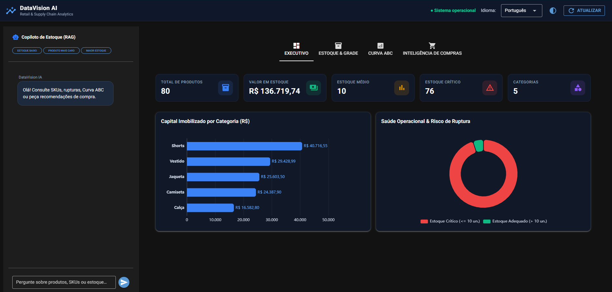
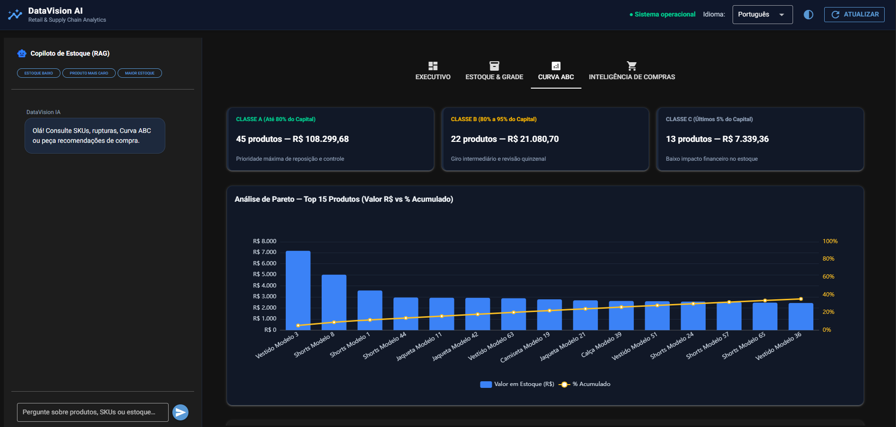
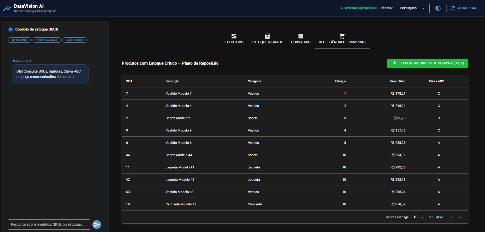

# 📊 DataVision AI — Retail & Supply Chain Analytics + Local SQL-RAG Copilot

[](https://www.python.org/)
[](https://fastapi.tiangolo.com/)
[](https://www.microsoft.com/sql-server)
[](https://nicegui.io/)
[](https://ollama.com/)

> 🇪🇸 **Español** | 🇬🇧 **English** *(Scroll down for English version)*

---

## 🇪🇸 Descripción del Proyecto

**DataVision AI** es una plataforma *full-stack* de **Business Intelligence e Inteligencia de Compras** para el sector retail, diseñada para conectar directamente con **Microsoft SQL Server**, calcular indicadores financieros y de inventario en tiempo real y ofrecer un **Copiloto de Datos (SQL-RAG)** ejecutado 100% en local mediante **Ollama (`qwen2.5:3b`)** sin enviar datos sensibles a la nube.

### 🎯 Problemas de Negocio Resueltos
* **Visibilidad Ejecutiva Instantánea:** Monitoreo del capital inmovilizado por categoría, stock promedio y tasa de riesgo de ruptura de inventario.
* **Clasificación Dinámica Curva ABC (Pareto 80/15/5):** Cálculo analítico resuelto directamente en SQL Server mediante **CTEs y Window Functions** (`SUM() OVER`), identificando qué SKUs concentran el 80% del capital (Clase A).
* **Inteligencia de Compras Accionable:** Priorización automática de productos en nivel crítico según su impacto financiero real (Clases A, B y C) con exportación directa de **Orden de Compra en formato `.CSV`** listo para Excel/ERP.
* **Copiloto Conversacional SQL-RAG:** Consultas en lenguaje natural (**Español, Inglés y Portugués**) con extracción determinística de extremos (*SKU más caro*, *mayor volumen*, *riesgo de ruptura*) y *fallback* automático si el servidor LLM está apagado.

### 🏗️ Arquitectura Técnica

```text
┌──────────────────────┐      REST / JSON       ┌──────────────────────────┐
│   NiceGUI Frontend   │ ◄────────────────────► │     FastAPI Backend      │
│  • Apache ECharts    │                        │  • Pydantic Settings     │
│  • Multi-User State  │                        │  • In-Memory TTL Cache   │
│  • i18n (ES/EN/PT)   │                        │  • Parameterized SQL     │
└──────────────────────┘                        └────────────┬─────────────┘
                                                             │
                                      ┌──────────────────────┴──────────────────────┐
                                      ▼                                             ▼
                        ┌───────────────────────────┐                 ┌───────────────────────────┐
                        │   Microsoft SQL Server    │                 │    Ollama Local Engine    │
                        │  • CTEs & Window Funcs    │                 │  • Model: qwen2.5:3b      │
                        │  • ABC Curve (80/15/5)    │                 │  • Zero Data Leakage      │
                        └───────────────────────────┘                 └───────────────────────────┘
```

### 📸 Capturas del Sistema / System Screenshots

#### 1. Panel Ejecutivo & Copiloto SQL-RAG


#### 2. Análisis de Pareto — Curva ABC (80/15/5)


#### 3. Inteligencia de Compras & Exportación CSV


---

## 🇬🇧 Project Overview

**DataVision AI** is a full-stack **Retail Business Intelligence & Procurement Analytics** application built on **Python, FastAPI, Microsoft SQL Server, NiceGUI, Apache ECharts, and Ollama**. It transforms raw inventory tables into executive KPIs, dynamic Pareto (ABC Curve) classifications, automated replenishment orders, and natural-language SQL-RAG insights running locally with zero external API costs.

### ✨ Key Engineering Highlights
* **Analytics Engineering in SQL Server:** ABC Curve (`80% / 15% / 5%` cumulative value) and size-grid breakdowns computed natively in T-SQL using Common Table Expressions (CTEs) and Window Functions (`ROWS UNBOUNDED PRECEDING`).
* **Low-Latency API Layer:** FastAPI backend featuring parameterized `pyodbc` queries (SQL-injection safe), 60-second TTL caching for analytical aggregations, and strict Pydantic schema validation.
* **Hallucination-Guarded Local RAG:** Grounds `qwen2.5:3b` with structured JSON payloads and pre-ranked absolute leaders (`#1 highest unit price`, `#1 highest stock`, critical stock alerts), preserving exact currency formatting and deterministic fallback resilience.
* **Session-Isolated Executive UI:** Built with NiceGUI and Apache ECharts, featuring per-user session state (`app.storage.user`), instant **ES / EN / PT** localization, Dark/Light themes, and one-click `.CSV` purchase order generation.

---

## 🚀 Instalación y Ejecución Local / Quick Start

### 1. Clonar el repositorio / Clone repository
```bash
git clone [https://github.com/RodolfoGiliard/datavision-ai.git](https://github.com/RodolfoGiliard/datavision-ai.git)
cd datavision-ai
```

### 2. Crear entorno virtual e instalar dependencias / Setup virtual environment
```bash
python -m venv .venv
# Windows PowerShell:
.venv\Scripts\Activate.ps1
# Linux / macOS:
source .venv/bin/activate

pip install -r requirements.txt
```

### 3. Configurar variables de entorno / Configure environment
Copia `.env.example` a `.env` y ajusta las credenciales de tu instancia de SQL Server:
```bash
cp .env.example .env
```

### 4. Iniciar el modelo local en Ollama / Pull local LLM
```bash
ollama pull qwen2.5:3b
```

### 5. Ejecutar Backend y Frontend / Run Services
En la **Terminal 1** (API FastAPI):
```bash
uvicorn main:app --host 127.0.0.1 --port 8000 --reload
```

En la **Terminal 2** (Dashboard NiceGUI):
```bash
python ui.py
```
Accede en el navegador a **`http://127.0.0.1:8080`**.

---

## 👨‍💻 Autor / Author

**Rodolfo Giliard Porto de Araújo** — *Data Analyst | Analytics Engineer | Python & SQL Developer*
* 🔗 GitHub: [@RodolfoGiliard](https://github.com/RodolfoGiliard)
